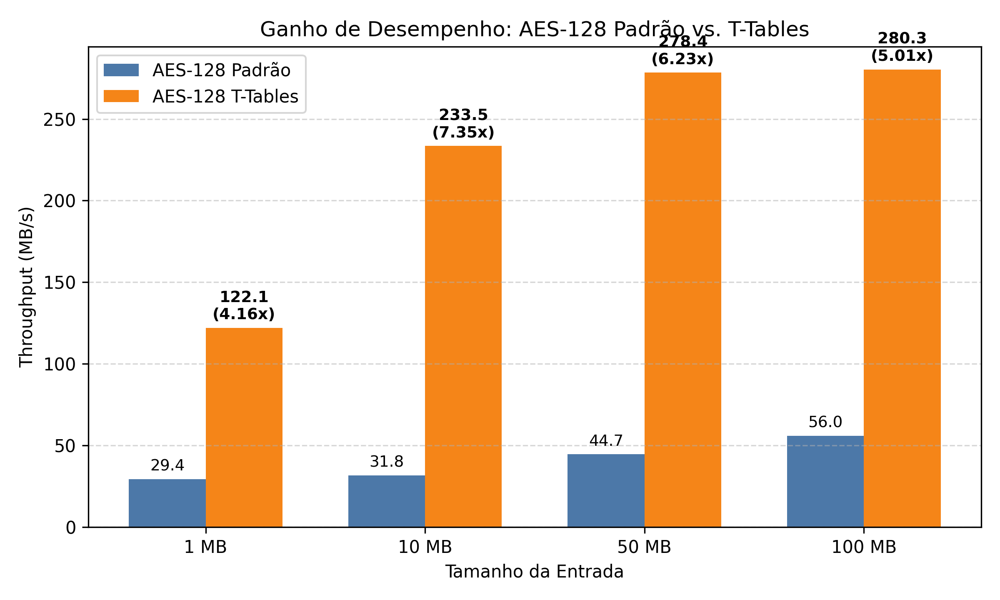
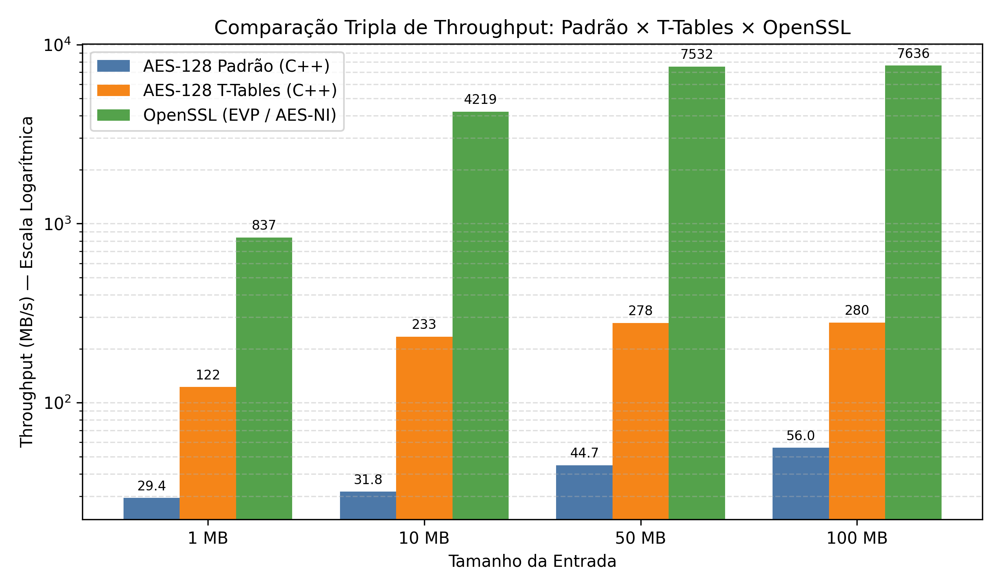

# AES-128 em C++

Trabalho de Projeto e Análise de Algoritmos (CTC04), Tema 1.10, Instituto de Matemática e Computação da UNIFEI.

Implementação do AES-128 feita do zero em C++, sem biblioteca externa no núcleo criptográfico. O projeto tem a versão padrão (as quatro transformações de cada rodada), uma versão otimizada com T-Tables e um benchmark que compara as duas com o OpenSSL.

## Equipe

| Integrante | Responsabilidade | 
| ----- | ----- | 
| Integrante 1 - Karol Luiza | Transformações básicas: SubBytes, ShiftRows, MixColumns e AddRoundKey | 
| Integrante 2 - Rafaella Gonzales | Expansão de chave, funções inversas, cifração/decifração e T-Tables | 
| Integrante 3 - Gabriel Furlan | Validação com vetores do NIST, benchmark e documentação | 

## Estrutura do repositório

```
src/
  aes_transformacoes.h / .cpp   quatro transformações da rodada e S-Box
  aes_cifrador.h / .cpp         expandirChave, inversas, cifrarBloco, decifrarBloco
  aes_ttables.cpp               cifrarBlocoTTables (versão com T-Tables)
tests/
  teste_transformacoes.cpp      confere a Rodada 1 do exemplo do Apêndice B do FIPS-197
  teste_cifrador.cpp            confere expansão de chave, cifração e decifração (Apêndices B e C.1)
main.cpp                        validação oficial completa (NIST FIPS-197 e consistência)
benchmark.cpp                   medição de desempenho (Padrão × T-Tables × OpenSSL)
gerar_graficos.py               geração dos gráficos comparativos a partir do CSV
resultados_benchmark.csv        dados exportados pelo benchmark
```

## Decisões de projeto

* Todo bloco de 128 bits é um `unsigned char estado[16]` em ordem de colunas (column-major): o byte `estado[4*c + r]` é a linha `r` da coluna `c`.
* As 11 subchaves ficam num único vetor de 176 bytes. A subchave da rodada `r` começa em `chavesRodada + 16 * r`.
* A S-Box só é acessada por `obterValorSBox()`. A S-Box inversa e as tabelas `T0..T3` são montadas quando o programa carrega, então não entram na medição do benchmark.
* `entrada` e `saida` das funções de bloco podem apontar para o mesmo buffer (*in-place*).

## Requisitos

* Linux (testado em Ubuntu 22.04.4 LTS)
* `g++` com suporte a C++11 ou superior
* Para o benchmark: OpenSSL com cabeçalhos de desenvolvimento (`libssl-dev`)
* Para os gráficos: Python 3 com `matplotlib` e `numpy`

```bash
sudo apt update
sudo apt install g++ libssl-dev
pip install matplotlib numpy
```

## Compilar e rodar os testes

Todos os comandos partem da raiz do repositório.

Transformações básicas (Integrante 1):

```bash
g++ -O2 -o teste_transformacoes src/aes_transformacoes.cpp tests/teste_transformacoes.cpp
./teste_transformacoes
```

Cifrador completo, versão padrão e T-Tables (Integrante 2):

```bash
g++ -O2 -o teste_cifrador src/aes_transformacoes.cpp src/aes_cifrador.cpp src/aes_ttables.cpp tests/teste_cifrador.cpp
./teste_cifrador
```

Suíte principal de validação NIST e consistência (Integrante 3):

```bash
g++ -O2 -o aes_validacao src/aes_transformacoes.cpp src/aes_cifrador.cpp src/aes_ttables.cpp main.cpp
./aes_validacao
```

A saída esperada termina com `Tudo certo`. Cada linha mostra `[PASSOU]` ou `[FALHOU]` para uma verificação.

## Validação

Os testes usam os vetores oficiais do NIST FIPS-197:

* **Apêndice A.1:** última subchave (rodada 10) gerada pela expansão da chave `2b7e1516 28aed2a6 abf71588 09cf4f3c`
* **Apêndice B:** texto claro `3243f6a8 885a308d 313198a2 e0370734` com a mesma chave, resultado `3925841d 02dc09fb dc118597 196a0b32`
* **Apêndice C.1:** chave `000102...0f`, texto claro `00112233...ff`, resultado `69c4e0d8 6a7b0430 d8cdb780 70b4c55a`

Além dos vetores oficiais, o `main.cpp` executa um teste de consistência em 1.000 blocos e chaves pseudoaleatórios verificando se a versão padrão e a versão com T-Tables geram exatamente o mesmo texto cifrado, se `decifrarBloco(cifrarBloco(M)) == M` e se a operação *in-place* (`entrada == saida`) funciona corretamente.

## Benchmark

### Metodologia

O `benchmark.cpp` compara o throughput (em MB/s) de três implementações de AES-128:

1. **AES-128 Padrão (C++):** implementação direta das 4 transformações por rodada.
2. **AES-128 T-Tables (C++):** versão otimizada com tabelas pré-computadas (`T0..T3`) de 32 bits.
3. **OpenSSL (`EVP_aes_128_ecb`):** baseline industrial via `<openssl/evp.h>` (utilizando aceleração por hardware AES-NI / VAES disponível na CPU).

Detalhes da execução:

* **Modo de operação:** ECB sem *padding*, operando sobre buffers contínuos com tamanhos múltiplos exatos de 16 bytes, para isolar o custo computacional puro do núcleo AES-128.
* **Tamanhos de entrada:** 1 MB, 10 MB, 50 MB e 100 MB preenchidos com bytes pseudoaleatórios.
* **Validação cruzada:** antes das medições, o programa cifra um buffer de 4 KB nas três implementações e garante igualdade bit a bit entre todas as saídas.
* **Medição de tempo:** utiliza `std::chrono::steady_clock`, com **1 execução de aquecimento (*warm-up*)** seguida da **média aritmética de 5 repetições** por tamanho de entrada. O throughput é calculado como $\text{Throughput} = \frac{\text{Tamanho (MB)}}{\text{Tempo médio (s)}}$.

### Compilação e execução

```bash
g++ -O2 -o benchmark src/aes_transformacoes.cpp src/aes_cifrador.cpp src/aes_ttables.cpp benchmark.cpp -lcrypto
./benchmark
```

Para gerar os gráficos a partir do `resultados_benchmark.csv` exportado pelo programa:

```bash
python3 gerar_graficos.py
```

### Resultados

| Tamanho | Padrão (MB/s) | T-Tables (MB/s) | OpenSSL (MB/s) | Speedup T-Tables | 
| ----- | ----- | ----- | ----- | ----- | 
| 1 MB | 29.37 | 122.12 | 837.46 | 4.16x | 
| 10 MB | 31.76 | 233.48 | 4218.88 | 7.35x | 
| 50 MB | 44.66 | 278.39 | 7531.62 | 6.23x | 
| 100 MB | 55.98 | 280.29 | 7635.86 | 5.01x | 

### Análise resumida

* **Ganho das T-Tables:** a fusão de `SubBytes`, `ShiftRows` e `MixColumns` em consultas de 32 bits proporcionou um *speedup* entre **4,16x e 7,35x** sobre a versão padrão (atingindo ~280 MB/s em 100 MB).
* **Comparação com OpenSSL:** o OpenSSL atingiu ~7,6 GB/s em 100 MB (~27x acima das T-Tables e ~136x acima da versão padrão), reflexo do uso de instruções dedicadas em hardware (**AES-NI** e **VAES** presentes no Intel Core i3-1115G4).
* **Efeito do tamanho do buffer:** em 1 MB, o tempo total de cifração é muito curto (especialmente no OpenSSL, ~1,19 ms), tornando proporcionalmente mais visível o custo fixo de inicialização do contexto `EVP` e o aquecimento de frequência da CPU; a partir de 50 MB, o throughput estabiliza.

### Gráficos





## Ambiente usado nas medições

* **Processador:** 11th Gen Intel(R) Core(TM) i3-1115G4 @ 3.00GHz (com suporte a `aes` / AES-NI, `vaes` e `avx512`)
* **Compilador:** `g++ (Ubuntu 11.4.0-1ubuntu1~22.04.3) 11.4.0` (flags: `-O2`)
* **OpenSSL:** `OpenSSL 3.0.2 15 Mar 2022`
* **Sistema Operacional:** Ubuntu 22.04.4 LTS

## Observações

Este código é um trabalho acadêmico. Ele serve para estudar o algoritmo e não deve ser usado para proteger dados reais: não há proteção contra ataques de canal lateral (as tabelas indexadas por dado secreto são justamente um exemplo clássico) e o modo ECB utilizado no benchmark existe apenas para medir desempenho de forma isolada.